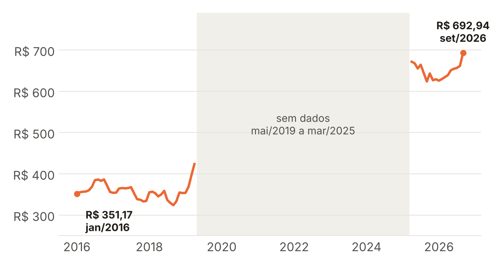
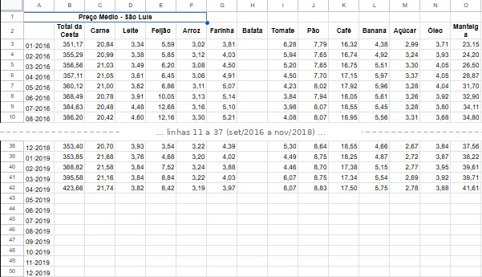
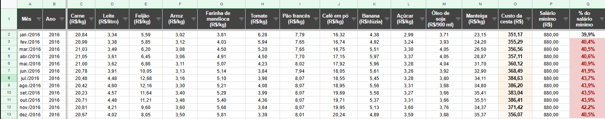
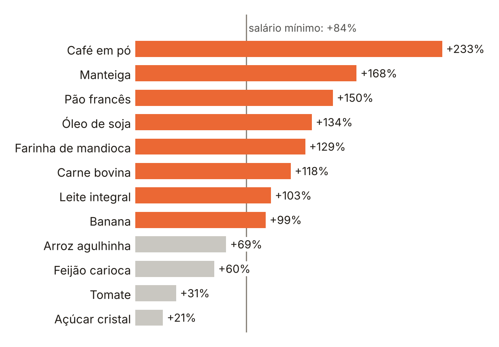
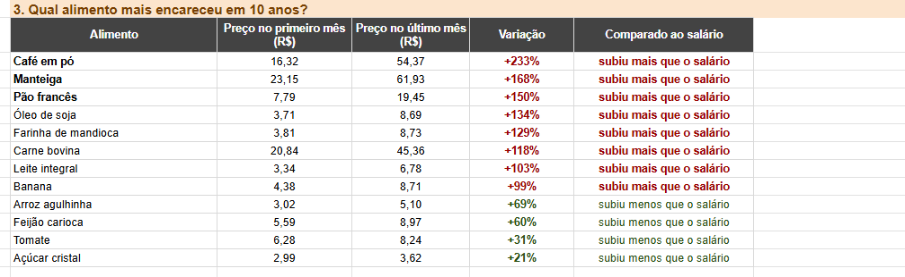

# A comida em São Luís subiu mais que o salário? Cesta básica de 2016 a 2026

Projeto de tratamento e análise de dados no Google Sheets, feito com dados públicos do DIEESE. Organizei 10 anos de preços da cesta básica de São Luís e comparei com o salário mínimo para descobrir se a comida ficou mais cara que a renda, quais alimentos mais encareceram e quais anos foram mais difíceis.

- **Planilha (Google Sheets):** [abrir planilha](https://docs.google.com/spreadsheets/d/1UBbWefl5_YxJfecr_Szq8CCzjhG-knXQGoQ5oaEDGZM/edit?usp=sharing)
- **Apresentação (PDF):** [apresentacao_cesta_basica_sao_luis_2016_2026.pdf](apresentacao/apresentacao_cesta_basica_sao_luis_2016_2026.pdf)



## Tema e usuário

**Situação:** o preço médio mensal dos 12 alimentos da cesta básica em São Luís, de jan/2016 a set/2026.

**Por que esse tema:** comida é o gasto mais básico de qualquer família. Saber se ela sobe mais rápido que o salário é uma pergunta real de economia doméstica e de política pública.

**Quem usaria:** famílias que vivem com salário mínimo, ONGs e programas que doam cestas, e jornalistas que acompanham o custo de vida.

## Dados

| | |
|---|---|
| Fonte | DIEESE, Pesquisa Nacional da Cesta Básica de Alimentos (Banco de Dados > Preço médio) |
| Recorte | São Luís · todos os produtos · 01/2016 a 09/2026 |
| Arquivo original | [`dados/dieese_preco_medio_sao_luis_2016_2026.xls`](dados/), sem alterações (129 meses) |
| Salário mínimo | R$ 880 (2016), 937 (2017), 954 (2018), 998 (2019), 1.518 (2025), 1.621 (2026) |

## Organização dos dados

**Antes** (aba "Dados brutos", trecho):



**Depois** (aba "Dados tratados"):



| Problema encontrado | Como resolvi |
|---|---|
| 71 dos 129 meses totalmente vazios (não há dados de São Luís de mai/2019 a mar/2025) | Filtrei as linhas em branco, removi e registrei a lacuna na aba de análises |
| Título e notas misturados com os dados | Removidos |
| Coluna "Batata" vazia (não faz parte da cesta do Norte/Nordeste) | Removida |
| Mês como texto (`01-2016`) | Convertido para data (jan/2016) e criada a coluna Ano com `ANO()` |
| Cabeçalhos curtos, sem unidade, e primeira coluna sem nome | Renomeados: "Mês", "Carne (R$/kg)" etc. |
| Não dava para comparar com a renda | Tabela de salário mínimo por ano + `PROCV` + coluna "% do salário mínimo" |

Resultado: **58 linhas** (1 linha = 1 mês com dados), com os preços dos 12 alimentos, o custo da cesta, o salário mínimo e o % do salário.

## Perguntas e respostas

| Pergunta | Funções | Resposta |
|---|---|---|
| Quanto a cesta subiu em 10 anos? | PROCV, SE | De R$ 351,17 para R$ 692,94 (+97,3%). O salário mínimo subiu 84,2% |
| Como foi cada ano? | CONT.SE, MÉDIASE, MÁXIMO, MÍNIMO, SE | 2025 foi o ano mais pesado (42,7% do salário, em média); 2018 o mais leve (36,3%) |
| Qual alimento mais encareceu? | PROCV, SE | Café (+233%), manteiga (+168%) e pão (+150%). 8 dos 12 subiram mais que o salário |
| Quando a cesta foi mais cara e mais barata? | MÁXIMO, MÍNIMO, MÉDIA | Mais cara: R$ 692,94 (set/2026). Mais barata: R$ 324,04 (set/2018) |
| Em quantos meses passou de 40% do salário? | CONT.SES, SOMA | 26 dos 58 meses, incluindo todos os 9 de 2025 |



Na planilha (aba "Análises", pergunta 3):



## Conclusões

- A cesta subiu 97% e o salário, 84%: o peso da cesta passou de 39,9% para 42,7% do salário mínimo.
- Os itens do café da manhã foram os que mais encareceram: café, manteiga e pão. Arroz, feijão, tomate e açúcar subiram menos que o salário.
- 2025 foi o ano mais pesado: em todos os meses com dados, a cesta passou de 40% do salário.
- **Decisão possível:** programas que doam cestas ou dão auxílio-alimentação devem reajustar o valor pelo preço dos alimentos, e não só pelo salário mínimo.

> Limitação: não há dados de mai/2019 a mar/2025 (período que inclui a pandemia), então a comparação é entre os dois períodos com dados.

## Estrutura do repositório

```
├── README.md
├── planilha/       cesta_basica_sao_luis_2016_2026.xlsx (cópia da planilha do Google Sheets)
├── dados/          dieese_preco_medio_sao_luis_2016_2026.xls (arquivo original do DIEESE)
├── apresentacao/   apresentacao_cesta_basica_sao_luis_2016_2026.pdf
└── imagens/        prints e gráficos usados neste README
```

## Ferramentas

Google Sheets: filtros, ordenação, formatação condicional e as funções SOMA, MÉDIA, MÁXIMO, MÍNIMO, CONT.SE, CONT.SES, MÉDIASE, PROCV, SE e ANO.

---

Feito por **Vinícius Lira Caldas** · [github.com/Vininy](https://github.com/Vininy)
